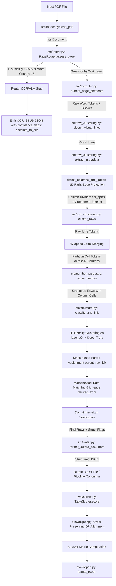

# Japanese Financial Table Parser — Architecture & System Design (`PARSER_ARCHITECTURE.md`)

This document provides a comprehensive technical overview of the Japanese Financial Table Parser architecture, its data flow, component responsibilities, error boundaries, and design trade-offs.

---

## 1. Problem Definition & Mission

Corporate disclosures in Japan (EDINET filings submitted to the Financial Services Agency, and TDnet timely disclosures on the Tokyo Stock Exchange) present financial statements—specifically consolidated balance sheets (`連結貸借対照表`)—as rich vector-graphic and native text PDFs.

Unlike machine-readable XBRL instances, PDF filings present severe extraction challenges:
1. **Typographic Indentation Hierarchy**: Account nesting is not indicated by explicit grid lines or tags, but by subtle horizontal indentation offsets ($\approx 9\,\text{pt}$ to $13\,\text{pt}$ increments across up to 5 nesting levels).
2. **Ambiguous Repeated Labels**: Identical account titles appear multiple times within the same statement (e.g., `減価償却累計額` appears 4 times, `その他` appears 4 times, `リース資産` appears twice). Resolving their identity requires strict document order and section hierarchy context.
3. **Accounting Notation & Signs**: Negative values use accounting triangle notation (`△` e.g. `△1,923,585`), solid triangle (`▲`), or parentheses `(1,234)`. Crucially, `"△0"` represents a non-null present value ($0$), distinct from nil or missing.
4. **Printed Nil vs. Parser Failure**: Printed dash markers (`－`, `-`, `—`) represent a reported zero or non-applicable balance (`status: "nil"`), which must never be conflated with an unreadable extraction failure (`status: "unreadable"`).
5. **Layout Variations & Scaling**: Different filers use different fonts, page margins, scaling factors, or 3+ numeric columns (e.g. 3 fiscal periods).
6. **Integrity & Router Quality**: Scanned image pages or corrupted fonts must be identified upfront, escalating to OCR rather than hallucinating confident wrong numbers.

---

## 2. Input / Output Contracts

### Inputs
- **Primary Input**: PDF document (`.pdf`) containing Japanese corporate financial statements.
- **Parameters**:
  - `pdf_path`: Filepath to the PDF.
  - `page_idx`: 0-based physical page index in the PDF document.
  - `page_num`: Optional nominal page number (if omitted, extracted adaptively from bottom footers).
  - `tolerance_per_term`: Parameterized tolerance for accounting sums (default: $\pm 1\,\text{unit}$ per summed term).
  - `password`: Optional string for encrypted PDFs.

### Outputs
- **Output Document**: A single canonical JSON structure conforming to the document schema:
  ```json
  {
    "page": 4,
    "extraction_method": "text_layer",
    "route_reason": "High character plausibility (100.0%), sufficient word count (132 words), and 83 numeric tokens detected.",
    "confidence_flags": [],
    "tables": [
      {
        "title_raw": "（１）連結貸借対照表",
        "unit": {"raw": "千円", "multiplier": 1000},
        "columns": [
          {"id": "c1", "header_raw": "前連結会計年度\n(2025 年３月 31 日)", "period_end": "2025-03-31"},
          {"id": "c2", "header_raw": "当連結会計年度\n(2026 年３月 31 日)", "period_end": "2026-03-31"}
        ],
        "rows": [
          {
            "row_idx": 17,
            "label_raw": "建物及び構築物（純額）",
            "type": "subtotal",
            "parent_row_idx": 14,
            "derived_from": [15, 16],
            "cells": {
              "c1": {"raw": "197,775", "status": "present", "value_in_unit": 197775},
              "c2": {"raw": "239,828", "status": "present", "value_in_unit": 239828}
            },
            "bbox": [114.24, 354.52, 522.55, 363.52]
          }
        ]
      }
    ]
  }
  ```

---

## 3. End-to-End Pipeline Flow (Mermaid Diagram)

The following diagram maps the exact runtime architecture executed by the parser:



---

## 4. Module Responsibilities & System Boundaries

| Module | Core Responsibility | Key Classes / Functions | Primary Inputs -> Outputs |
| :--- | :--- | :--- | :--- |
| **`src/loader.py`** | Safe PDF document ingestion, decryption handling, corruption and page count gating. | `load_pdf()`, `PDFLoadError` | `(pdf_path: str, password)` $\rightarrow$ `fitz.Document` |
| **`src/router.py`** | Upfront text layer trust assessment. Detects raster-only pages, replacement character corruption (`\ufffd`), and table token sanity. | `PageRouter.assess_page()`, `is_plausible_char()` | `fitz.Page` $\rightarrow$ `routing_info: Dict` |
| **`src/extractor.py`** | Low-level geometric token extraction from PyMuPDF text layer. | `extract_page_elements()` | `fitz.Page` $\rightarrow$ `List[Dict]` (word tokens with coordinates) |
| **`src/row_clustering.py`** | Vertical line clustering, adaptive font height scaling, dynamic $N$-column detection via right-edge projection profile, label gutter estimation, wrapped label merging, and cell assignment. | `RowClusterer`, `compute_adaptive_y_tolerance()`, `detect_columns_and_gutter()`, `extract_metadata()`, `cluster_rows()` | `words: List[Dict]` $\rightarrow$ `lines, columns, rows` |
| **`src/number_parser.py`** | Pure functional NFKC normalization, accounting negative resolution (`△`, `▲`, `(x)`), zero preservation (`△0`), nil marker handling (`－`), and Japanese ISO date parsing. | `parse_number()`, `normalize_date_to_iso()` | `raw_str: Optional[str]` $\rightarrow$ `(status, value_in_unit)` |
| **`src/structure.py`** | 1D density clustering of `label_x0` for adaptive nesting tiers, stack-based parent resolution, general total suffix classification, mathematical lineage derivation (`derived_from`), and internal invariant auditing. | `StructureClassifier.classify_and_link()` | `rows: List[Dict], columns` $\rightarrow$ `linked_rows, struct_flags` |
| **`src/writer.py`** | Serialization of final extracted structures into canonical JSON conforming to output schema with UTF-8 preservation. | `format_output_document()`, `save_output_json()` | `tables, flags, metadata` $\rightarrow$ `Dict[str, Any]` |
| **`src/parser.py`** | Orchestrator tying together loading, routing, extraction, clustering, classification, and diagnostics into a unified API. | `FinancialTableParser.parse_pdf()`, `parse_page()` | `(pdf_path, page_idx)` $\rightarrow$ `Dict[str, Any]` |
| **`eval/aligner.py`** | Circularity-free order-preserving DP alignment (edit-distance with section context and drift penalty). Excludes cell numbers from matching cost. | `RowAligner.align()`, `match_cost()`, `normalize_label()` | `(gt_rows, pred_rows)` $\rightarrow$ `alignment_result: Dict` |
| **`eval/scorer.py`** | Strict layered evaluation engine: Page Gate $\rightarrow$ Alignment $\rightarrow$ Cell Raw $\rightarrow$ Value Parsing $\rightarrow$ Hierarchy $\rightarrow$ Invariants. | `TableScorer.score()`, `check_invariants()` | `(gt_doc, pred_doc)` $\rightarrow$ `score_dict: Dict` |
| **`eval/report.py`** | Human-readable terminal and markdown evaluation summary generator. | `format_report()` | `score_dict` $\rightarrow$ `str` (formatted report) |

---

## 5. Module Dependency Map

The dependency graph demonstrates strict unidirectional flow with clear separation between extraction logic and evaluation scoring:

```
run_pipeline.py
  ├── src.parser (FinancialTableParser)
  │     ├── src.loader (load_pdf)
  │     ├── src.router (PageRouter)
  │     ├── src.extractor (extract_page_elements)
  │     ├── src.row_clustering (RowClusterer)
  │     │     └── src.number_parser (parse_number, normalize_date_to_iso)
  │     ├── src.structure (StructureClassifier)
  │     │     └── eval.aligner (normalize_label)
  │     └── src.writer (format_output_document, save_output_json)
  ├── eval.scorer (TableScorer)
  │     └── eval.aligner (RowAligner, normalize_label)
  └── eval.report (format_report)
```

---

## 6. Intermediate Data Representations

1. **`words` (`src/extractor.py`)**:
   List of individual token dictionaries extracted directly from PyMuPDF:
   `{"text": str, "bbox": [x0, y0, x1, y1], "x0": float, "y0": float, "x1": float, "y1": float, "block_no": int, "line_no": int, "word_no": int}`.
2. **`lines` (`src/row_clustering.py`)**:
   List of visual lines, where each line is a list of word token dictionaries whose mid-$y$ coordinates fall within adaptive vertical tolerance:
   `List[List[Dict[str, Any]]]`.
3. **`raw_row_candidates` (`src/row_clustering.py`)**:
   Horizontal slices partitioned into a label region ($x_1 \le x_{\text{gutter}}$) and a value token region ($x_0 > x_{\text{gutter}}$):
   `{"label_raw": str, "label_x0": float, "value_tokens": List[Dict], "bbox": List[float], "has_values": bool}`.
4. **`merged_candidates` (`src/row_clustering.py`)**:
   Candidates where multi-line wrapped account names (e.g., long titles broken over two lines) are merged prior to cell assignment.
5. **`final_rows` (pre-structure)**:
   Rows with column cells populated:
   `{"row_idx": int, "label_raw": str, "cells": {"c1": {...}, "c2": {...}}, "bbox": [...]}`.
6. **`linked_rows` (`src/structure.py`)**:
   Fully classified rows containing `type`, `parent_row_idx`, and mathematical lineage `derived_from`.

---

## 7. Error Handling & Fail-Loud Architecture

The parser adheres to a strict fail-loud design: **it must never emit confident wrong data from an ambiguous document without flagging it**.

Errors are partitioned into two architectural tiers:
1. **Fatal Ingestion Failures** (raise explicit Python exceptions):
   - `FileNotFoundError`: Missing PDF file path.
   - `PDFLoadError`: Password-protected PDF without authentication, corrupted file structure, or 0-page document.
2. **Diagnostic Fallbacks** (recorded in `confidence_flags` without crashing):
   - `escalate_to_ocr`: Native text layer is missing or character plausibility drops below 85%.
   - `text_layer_missing`: Page has $< 15$ words or is purely whitespace.
   - `low_char_plausibility`: Page has $> 15\%$ replacement (`\ufffd`) or private-use code points.
   - `column_boundaries_ambiguous`: Numeric tokens across rows do not form distinct right-edge clusters; parser falls back to default spacing and flags the ambiguity.
   - `hierarchy_unavailable`: All labels have identical indentation ($< 2$ depth tiers); parent pointers are set to `null` rather than guessing false trees.
   - `invariants_failed`: Line items sum to a value different from the reported subtotal beyond tolerance; failing item names are listed.
   - `header_or_unit_not_found`: Table title, unit, or column dates could not be identified in the header block.
